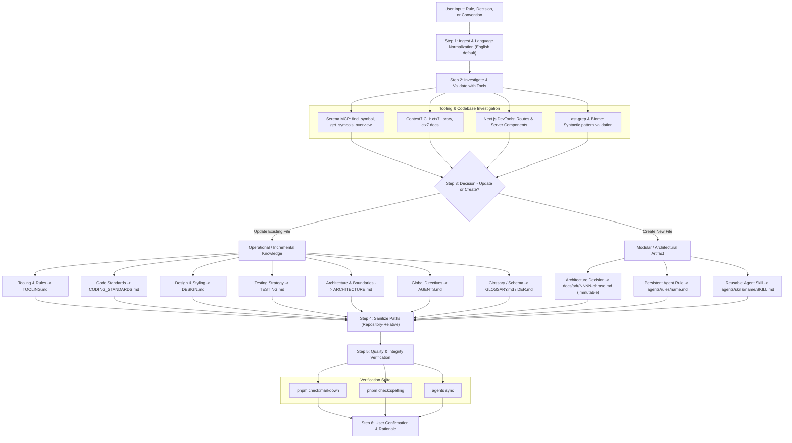

# Save Knowledge & Project Rules

This skill governs how to classify, locate, and record knowledge, rules, decisions, and operational instructions provided by the user or discovered during development.

## Core Principles

1. **English by default**: All documentation, code comments, and rule descriptions must be in English per [.agents/rules/language.md](../../rules/language.md), even if the user provided the input in another language (e.g., Portuguese).
2. **Strict path portability**: NEVER store hardcoded host-specific or user-specific absolute paths (such as user home directories, drive prefixes, or machine root paths). Always sanitize and convert paths to repository-relative format (e.g., `TOOLING.md`, `src/app/`, `.agents/rules/`).
3. **Single source of truth**: Store each rule or piece of knowledge in its authoritative canonical document. Do not duplicate rules across multiple guides.
4. **ADR immutability**: Accepted Architecture Decision Records (`docs/adr/0001-*` through current) are historical and immutable per [.agents/rules/adr-naming.md](../../rules/adr-naming.md). Never rewrite, edit, or renumber an accepted record.

---

## Decision Matrix: Information Type to Destination

Use this matrix to identify the canonical destination file for any given piece of information:

| Information Type | Description & Examples | Target File | Action |
| --- | --- | --- | --- |
| **Tool inventory & host dependencies** | Host prerequisites, package managers, CLI tools, runtime versions, build tools | `TOOLING.md` (## Tool inventory, ## Host prerequisites) | **Update** |
| **Commands & scripts** | Package scripts, verification commands, audit commands | `TOOLING.md` (## Commands, ### Verification entry points) | **Update** |
| **Configuration sources** | Roles and locations of config files (`biome.json`, `next.config.ts`, etc.) | `TOOLING.md` (## Configuration sources) | **Update** |
| **Custom code quality rules** | Biome GritQL rules, ast-grep structural rules, Semgrep static security rules | `TOOLING.md` (## Custom rule registry) | **Update** |
| **Known tooling limitations** | Workarounds, tool quirks, exclusions, upstream bugs | `TOOLING.md` (## Known limitations) | **Update** |
| **Coding & styling conventions** | TypeScript standards, React patterns, Next.js practices, import ordering | `CODING_STANDARDS.md` | **Update** |
| **Design tokens & UI components** | Colors, spacing, typography, theme tokens, shadcn components, Ladle stories | `DESIGN.md` | **Update** |
| **Testing strategy & practices** | Unit, integration, browser, e2e, a11y, visual, mutation test practices | `TESTING.md` | **Update** |
| **Git workflow & contributions** | Branch naming, Conventional Commits, PR guidelines, git hooks | `CONTRIBUTING.md` | **Update** |
| **Security policies** | Vulnerability handling, security scanners, ignored security advisories | `SECURITY.md` | **Update** |
| **Architecture & layering** | Repository layers, boundary rules, routing architecture, i18n structure | `ARCHITECTURE.md` | **Update** |
| **Domain vocabulary** | Business terms, ubiquitous language definitions | `GLOSSARY.md` | **Update** |
| **Database & persistence schema** | Entity-relationship model, tables, columns, relations, storage | `DER.md` | **Update / Create** |
| **Global agent directives** | Overall mission, high-level engineering rules, documentation map for agents | `AGENTS.md` | **Update** |
| **Agent tool configuration** | MCP servers, client integrations, sync settings | `.agents/agents.json` | **Update** |
| **Persistent agent rules** | Standalone, enforce-everywhere agent constraints (e.g., language, naming) | `.agents/rules/<name>.md` | **Create** |
| **Reusable agent skills** | Multi-step interactive agent workflows, tool guides, reusable recipes | `.agents/skills/<name>/SKILL.md` | **Create** |
| **Architecture Decision Records (ADRs)** | Architectural choices, trade-offs, tech evaluations, paradigm changes | `docs/adr/NNNN-<phrase>.md` | **Create** (Immutable) |

---

## When to Update vs When to Create

Follow these strict boundaries when persisting information:

### When to UPDATE an Existing File

Modify an existing document when the user's information refines, extends, or updates established operational practices:

- **`TOOLING.md`**:
  - Adding or upgrading a developer tool or dependency.
  - Adding a custom lint/ast rule to the Custom Rule Registry (table in `TOOLING.md`).
  - Adding a verification or maintenance command to the command tables.
  - Recording a known tool limitation, vendor exclusion, or advisory exception.
- **`CODING_STANDARDS.md`**:
  - Adding or refining a TypeScript convention, React idiom, Next.js guideline, or file structure rule.
- **`DESIGN.md`**:
  - Updating design tokens, color palette definitions, typography scales, or component guidelines.
- **`TESTING.md`**:
  - Adding testing patterns, assertion guidelines, coverage expectations, or mocking conventions.
- **`AGENTS.md`**:
  - Updating high-level guidance, repository-wide rules, or indices of skills and MCP servers.
- **`ARCHITECTURE.md`**:
  - Clarifying module boundaries, layer dependency rules, or internationalization flow.
- **`GLOSSARY.md` / `DER.md`**:
  - Updating product terms or database entities as the domain model evolves.
- **`CONTRIBUTING.md` / `SECURITY.md`**:
  - Refining contribution guidelines, PR criteria, or security vulnerability procedures.

### When to CREATE a New File

Create a new file only when the information constitutes a distinct, modular artifact:

1. **Architecture Decision Records (`docs/adr/NNNN-<phrase>.md`)**:
  - **Trigger**: A significant architectural, structural, or technology choice that requires recording context, options considered, decision, and consequences.
  - **Immutability rule**: Accepted ADRs are strictly immutable per [.agents/rules/adr-naming.md](../../rules/adr-naming.md). Never edit or rewrite accepted records.
  - **Naming format**: Next unused four-digit number followed by a kebab-case imperative phrase (e.g., `0009-adopt-database-orm.md`).
  - **Index update**: After creating the ADR, add its entry to `docs/adr/README.md`. If superseding an earlier ADR, note the supersession in `docs/adr/README.md` and in the new ADR.
2. **Agent Persistent Rules (`.agents/rules/<name>.md`)**:
  - **Trigger**: A discrete, persistent behavioral constraint that applies to all coding agents working across the repository (e.g., formatting constraints, commit constraints, language requirements).
  - **Format**: Concise markdown document focusing solely on the rule, its rationale, and mandatory requirements.
3. **Reusable Agent Skills (`.agents/skills/<name>/SKILL.md`)**:
  - **Trigger**: A complex, multi-step interactive workflow, domain-specific procedure, or tool guide that agents should load on demand.
  - **Format**: Directory named with kebab-case, containing `SKILL.md` with YAML front matter (`name` and `description`).
  - **Registration**: Register new skills in `.agents/skills/README.md`, `.agents/README.md`, and `TOOLING.md`.

---

## Investigation Tools for Rule Verification

Before persisting a rule, convention, or architectural decision, verify whether the rule reflects current repository code and upstream library reality. Use the following specialized tools:

### 1. Serena (Semantic Symbol Analysis MCP)
Serena provides project-local semantic symbol indexing and code navigation. Use it to inspect codebase symbols, verify whether conventions or patterns are already in use, locate relevant components, and validate symbols before saving rules or standards:
- `find_symbol`: Verify whether an interface, class, component, or helper function already exists in `src/` (e.g., checking if `ButtonProps` or `ThemeToggle` follows the proposed naming convention).
- `get_symbols_overview`: Inspect the top-level symbols of a file or module before drafting coding standards for that file type.
- `find_referencing_symbols`: Determine how widely a symbol or convention is used across the codebase before establishing a deprecation or replacement rule.
- `find_implementations`: Discover all implementations of a base interface or type (e.g., exploring existing layout props or route handlers).

### 2. Context7 (`context7-cli`)
When the user's rule touches external dependencies or framework capabilities (Next.js 16, React 19, Tailwind CSS v4, shadcn/ui, `next-intl`), check authoritative upstream documentation instead of relying on outdated training data:
- Step 1: Resolve the library ID:
  ```bash
  ctx7 library <library-name> [query]
  ```
- Step 2: Query documentation:
  ```bash
  ctx7 docs <library-id> <query>
  ```
- Example: Verify current Next.js 16 Server Actions signatures or Tailwind v4 `@theme` directives before documenting them in `CODING_STANDARDS.md` or `DESIGN.md`.

### 3. Next.js DevTools MCP
When establishing rules around routing, server vs. client component boundaries, or runtime performance:
- Use Next.js DevTools to inspect route segments, server-rendered components, and client boundary hooks.
- Validate route naming conventions, layout nesting rules, or metadata export expectations against actual route trees.

### 4. ast-grep & Biome
When turning a coding convention into an enforceable automated rule:
- **Biome GritQL**: Use GritQL plugins in `.biome/rules/` to enforce Next.js route, page, and layout prop types. Regression-test them in `.biome/rules/nextjs/rules.test.ts`.
- **ast-grep**: Use `sgconfig.yml` and `.ast-grep/` for syntax-aware pattern enforcement (e.g., forbidding dynamic class names or manual memoization). Run snapshot tests via `pnpm check:structure`.
- If an automated rule is created, record it in the **Custom rule registry** table in `TOOLING.md`.

---

## End-to-End Decision & Execution Flow

### Mermaid Flowchart



---

## Step-by-Step Execution Workflow

When a user requests to save or document information (e.g., "save this rule", "salve essa regra no TOOLING.md", "lembre-se dessa convenção"):

### 1. Ingest & Interpret
- Extract the core rule, convention, architectural decision, or tool specification from the user's input.
- Check the language: if input is in Portuguese or another language, translate the technical guidance into idiomatic English for storage (per [.agents/rules/language.md](../../rules/language.md)).

### 2. Sanitize & Normalize
- **Remove absolute machine paths**: Replace machine-specific absolute paths (such as full workspace paths or user directory prefixes) with repository-relative paths (e.g., `TOOLING.md`).
- Ensure code snippets follow repository coding standards (TypeScript, Biome formatting).

### 3. Classify & Select Target
- Consult the [Decision Matrix](#decision-matrix-information-type-to-destination).
- Decide between **UPDATE** and **CREATE** using the criteria above.
- If the user explicitly nominated a target file (e.g., `TOOLING.md`), verify that the information fits that file's ownership scope in `docs/README.md`. If a more specific or appropriate document exists (e.g., an ADR vs updating `TOOLING.md`), explain the choice.

### 4. Apply Changes
- **For Updates**:
  1. Read the target section in the existing document.
  2. Locate the appropriate table or section heading.
  3. Insert or update the content using consistent Markdown structure (table rows, lists, headings).
- **For Creates**:
  1. Verify the next sequential number (for ADRs) or appropriate naming convention.
  2. Write the new document with clear headings, context, and rationale.
  3. Update related index files (`docs/adr/README.md` for ADRs, `.agents/skills/README.md` for skills).

### 5. Quality Assurance & Verification
Run the following checks to ensure repository integrity:

```bash
# 1. Verify markdown formatting
pnpm check:markdown

# 2. Verify spelling across code and documentation
pnpm check:spelling

# 3. Synchronize agent skill manifests (when .agents/ is modified)
agents sync
```

### 6. Confirm to User
Provide a concise summary of the action taken:
- The target file path (repository-relative).
- The section or table updated, or the new file created.
- The rationale for the chosen target.
- Results of verification checks.
